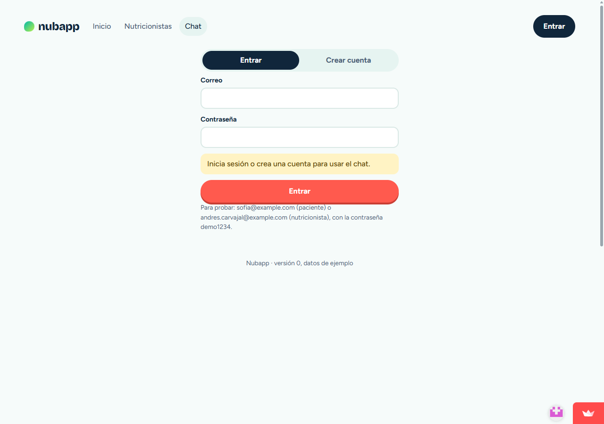

# Nubapp

**Enlace a la app:** https://nubapp-xydvqiwcxs97xbsrhfchvz.streamlit.app/
**Autor:** Jairo Peña

## Pitch

Encontrar al nutricionista adecuado es lento: hay muchos perfiles y casi nadie sabe qué especialidad necesita. Nubapp reúne a nutricionistas de varias especialidades (pediátrico, oncológico, TCA, endocrino-obesidad, enfermedad renal, deportivo, vegetarianismo/veganismo, embarazo y maternidad) y deja que el paciente reserve cita en un minuto. La IA (API de Gemini) conversa con el paciente, entiende su necesidad y le recomienda de 1 a 3 especialistas del pool, explicando por qué, sin dar diagnósticos ni dietas. En las pruebas, el chat recomendó a la especialidad correcta en los 5 casos que probamos, incluido uno fuera de tema que rechazó con amabilidad; y aprendimos que el prompt necesitaba una regla explícita para que los nombres que cita coincidan siempre con las tarjetas que muestra. Lo siguiente sería una base de datos persistente, recordatorios por correo y pagos.

## El problema

Quien necesita un nutricionista (una madre con un niño que casi no come, una persona con diabetes, un ciclista que quiere rendir mejor) hoy busca en directorios genéricos o pregunta a conocidos, sin saber qué especialidad le conviene ni si tiene hueco esta semana. Los nutricionistas, por su parte, tienen poca visibilidad para destacar justo lo que mejor saben hacer y muchos hacen intentos que no generan resultados por redes sociales y medios similares. Merece la pena resolverlo porque una buena orientación al inicio ahorra consultas equivocadas y hace que la gente empiece antes su tratamiento de manera asertiva.

## Qué hace la app

Hay dos tipos de usuario. Los nutricionistas se registran, completan su perfil (frase de presentación, especialidades, servicios con duración y precio, modalidad e idiomas) y publican sus horarios libres; aparecen en el listado cuando tienen frase, especialidad y al menos un servicio. Los pacientes se registran o inician sesión y pueden explorar el listado, filtrando por especialidad y modalidad.

El chat con Nubi solo se abre con la sesión iniciada. El paciente cuenta lo que necesita y recibe de 1 a 3 tarjetas de nutricionistas, y desde ellas abre el perfil. Para reservar elige servicio, día y hora libres, escribe el motivo y confirma; un horario ocupado no se puede reservar dos veces. En su panel, paciente y nutricionista ven sus citas y pueden cancelarlas, y el hueco queda libre otra vez.

Para probar sin crear cuenta, usa las cuentas ficticias de [credenciales_prueba.md](credenciales_prueba.md).

## La pieza de IA

La app usa la API de Gemini con el SDK `google-genai` y el modelo `gemini-flash-lite-latest` (constante `MODELO` en `app.py`). Lo elegí porque es rápido y barato, y la tarea se reduce a clasificar una necesidad en una especialidad. En cada turno Gemini recibe la conversación y la lista de nutricionistas (id, especialidades, servicios, ciudad, modalidad) y devuelve un JSON `{mensaje, ids}` validado con pydantic. El texto y los ids van separados para que la app dibuje tarjetas reales, y cualquier id que no exista en el pool se descarta, de modo que la IA no puede inventar profesionales.

El prompt de sistema usa negative prompting: le prohíbe dar diagnósticos, dietas, cantidades de comida, suplementos o consejo médico, y le pide que ante una urgencia recomiende acudir a un profesional de la salud. Si el mensaje no tiene que ver con nutrición, responde que solo ayuda a encontrar un nutricionista.

Si se acaba la cuota, no hay conexión o la respuesta no es válida, el chat cae a una recomendación básica por palabras clave y avisa al usuario ("El asistente no está disponible ahora mismo…"). El listado y la reserva siguen funcionando. La clave vive en `st.secrets` y solo la usa Python, así que nunca llega al navegador.

## Cómo la he construido

Trabajé con Claude Code, con las skills `frontend-design` y `grill-me`, el plugin `ponytail` y el MCP `chrome-devtools` para ver y depurar la interfaz en un navegador real. El fichero de contexto del agente es [CLAUDE.md](CLAUDE.md).

La app es Python 3.14 con Streamlit (requisito del template de la maestría) y una interfaz en React que se carga como componente de Streamlit. Streamlit Cloud no ejecuta Node, por eso `frontend/dist/` (React compilado con Vite) está en el repositorio. Toda la lógica (login con `scrypt`, SQLite, Gemini, reservas) vive en `app.py`; React solo muestra datos y devuelve eventos. La base es SQLite con el módulo estándar. En Streamlit Cloud el disco es efímero: las cuentas y citas nuevas se pierden al reiniciar y los datos de ejemplo se vuelven a cargar. La sesión vive en Streamlit, así que recargar la página la cierra.

Prompts que más me sirvieron:

- Restricción explícita (negative prompting): "lo mantenemos en python si o si pero se puede usar un framework moderno junto?"
- Restricción explícita (negative prompting), con el motivo: "nivel 2 siempre que nos mantengamos en streamlit, eso es fundamental.. no hay opción de que el stack base sea diferente a como se planteó en el claude.md inicial"
- Delegar con límites: "El stack tecnológico debe ser muy básico inicialmente. Si usamos una base de datos debe poder correr en streamlit (algo como sqlite sirve?) tú te encargas del modelamiento"
- Cuestionar al agente con las reglas del proyecto: "las credenciales del api key no debían ir en un archivo llamado "st.secrets"?"
- Regla de producto: "a la sección del chat sólo deberían poder entrar personas que estén logueadas"
- Pasar las pruebas al agente: "eres el encargado de las pruebas, sea con devtools o si prefieres instalar playwright"

Delegué al agente el esqueleto de la app, el modelo de datos, el componente React y los casos de prueba. Yo revisé las decisiones de arquitectura (el agente propuso React puro con Node y exigí quedarnos en Streamlit), el diseño (frutas y verduras, uso de pantallas grandes) y la regla de que el chat exija sesión. El agente comprobó la app con pruebas y con el navegador: así salió que el modelo inicial de Gemini ya no estaba disponible (al llamar a la API) y que la interfaz tenía zonas vacías a los lados (en el navegador). Dos fallos de lógica, la reserva tras cancelar y el nutricionista nuevo sin perfil, aparecieron al revisar el código y se confirmaron después con pruebas.

## Prueba y mejora

| Quién la probó | Qué probó | Qué pasó | Qué cambié |
|---|---|---|---|
| Jairo Peña, como paciente | Chat: "Soy ciclista y quiero mejorar mi rendimiento y recuperación" | Recomendó a los dos nutricionistas deportivos | — |
| Jairo Peña, como paciente | Chat: "Mi hija de 6 años come muy poco y es muy selectiva" | Recomendó pediátricos (en la interfaz, a Valeria Montoya y Noa Benedetti) | — |
| Claude Code, como paciente | Chat: "Me acaban de diagnosticar diabetes tipo 2" | La IA nombró a un especialista en el texto pero no devolvió su tarjeta | Añadí al prompt: si nombras a alguien, su id debe ir en `ids` |
| Jairo Peña, como paciente | Chat: "Tengo problemas hepaticos y quisiera tener una dieta balanceada que me ayude" | No dio dieta: dijo que eso lo verá el especialista en consulta, que no hay un nutricionista de hígado en la lista y que consulte a su médico tratante | — |
| Claude Code, como paciente | Chat: "¿Qué tiempo hará mañana?" | Dijo amablemente que solo ayuda a encontrar un nutricionista | — |
| Claude Code, sin sesión | Abrir el chat desde el menú y escribir en la portada | Pide iniciar sesión; al entrar, el mensaje escrito se responde con Gemini | — |
| Claude Code, en la app desplegada | Reservar y cancelar como paciente; registrarse como nutricionista, completar el perfil y aparecer en el listado | Todo funcionó. Dos detalles: el campo "Tarifa desde" no se veía en ninguna parte (la tarjeta muestra el precio del servicio) y las fechas salían con "De" en mayúscula | Quité el campo de tarifa del editor y corregí la mayúscula |
| Claude Code, revisando el código | Reservar un hueco, cancelarlo y volver a reservarlo | Detectado en la revisión antes de ejecutar: la restricción única de la base de datos impediría la segunda reserva | La restricción pasó a aplicarse solo a citas confirmadas; luego se probó que reservar, cancelar y reservar de nuevo funciona |
| Claude Code, revisando el código | Registrarse como nutricionista y buscarse en el listado | Detectado en la revisión: no se creaba su perfil y no aparecería en el listado | Se crea un perfil vacío al registrarse y se añadió el editor; luego se probó en el navegador |
| Claude Code, en móvil y pantalla ancha | Revisar la interfaz | Zonas vacías a los lados y frutas pegadas al título | Se amplió el ancho máximo y se separaron las decoraciones |

Además hay 21 pruebas automáticas de la lógica (login, reservas, cancelaciones, perfil del nutricionista, respaldo del chat y recomendaciones reales de Gemini): `pip install pytest` y `python -m pytest`.
Claude Code usó el MCP chrome devtools para dichas pruebas.

## Ejecutar en local (opcional)

```bash
pip install -r requirements.txt
# poned la clave en .streamlit/secrets.toml:  GEMINI_API_KEY = "…"
streamlit run app.py
```

Para modificar la interfaz hace falta Node.js LTS:

```bash
cd frontend
npm install
npm run build   # regenera frontend/dist, que es lo que carga Streamlit
```

## Capturas

| Escritorio | Móvil |
|---|---|
|  |  |

Chat con Gemini recomendando especialistas (sesión de paciente de prueba):


Caso límite: intentar usar el chat sin haber iniciado sesión (app desplegada).



Un momento del trabajo con la IA: la sesión de Claude Code en VS Code.


