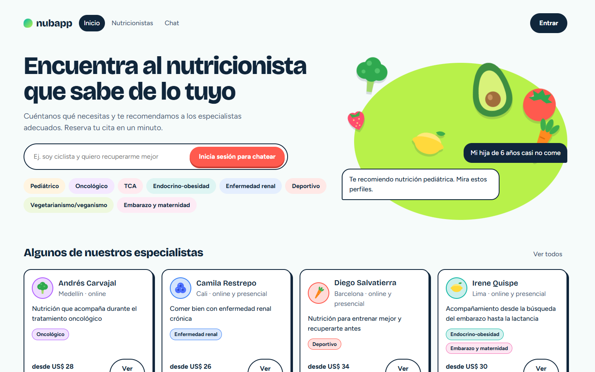
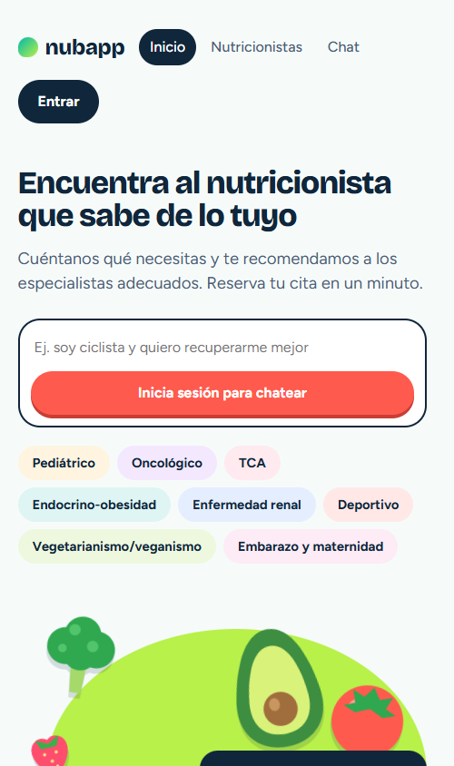
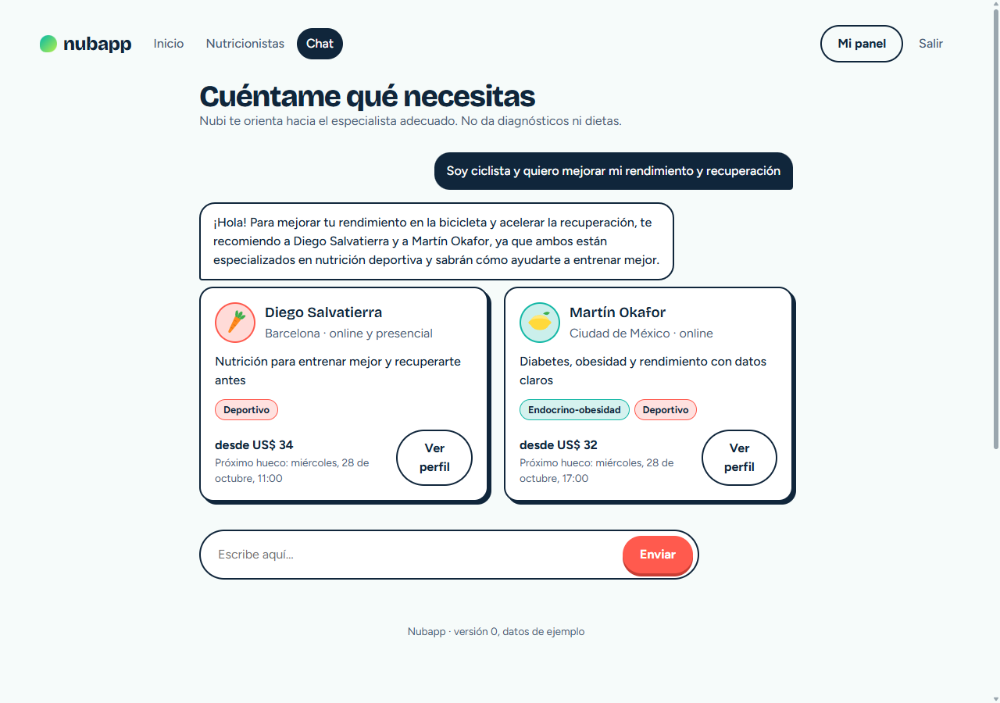

# Nubapp

**Enlace a la app:** https://nubapp-xydvqiwcxs97xbsrhfchvz.streamlit.app/
**Autor:** Jairo Peña

## Pitch

Encontrar al nutricionista adecuado es lento: hay muchos perfiles y casi nadie sabe qué especialidad necesita. Nubapp reúne a nutricionistas de ocho especialidades (pediátrico, oncológico, TCA, endocrino-obesidad, enfermedad renal, deportivo, vegetarianismo/veganismo, embarazo y maternidad) y deja que el paciente reserve cita en un minuto. La IA (API de Gemini) conversa con el paciente, entiende su necesidad y le recomienda de 1 a 3 especialistas del pool, explicando por qué, sin dar diagnósticos ni dietas. En las pruebas, el chat recomendó a la especialidad correcta en los 4 casos que probamos, incluido uno fuera de tema que rechazó con amabilidad; y aprendimos que el prompt necesitaba una regla explícita para que los nombres que cita coincidan siempre con las tarjetas que muestra. Lo siguiente sería una base de datos persistente, recordatorios por correo y pagos.

## El problema

Quien necesita un nutricionista (una madre con un niño que casi no come, una persona con diabetes, un ciclista que quiere rendir mejor) hoy busca en directorios genéricos o pregunta a conocidos, sin saber qué especialidad le conviene ni si tiene hueco esta semana. Los nutricionistas, por su parte, tienen poca visibilidad para destacar justo lo que mejor saben hacer. Merece la pena resolverlo porque una buena orientación al inicio ahorra consultas equivocadas y hace que la gente empiece antes su tratamiento.

## Qué hace la app

1. **Nutricionistas:** se registran, completan su perfil (frase de presentación, especialidades, servicios con duración y precio, modalidad, idiomas) y publican sus horarios libres. Aparecen en el listado cuando tienen frase, especialidad y al menos un servicio.
2. **Pacientes:** se registran o inician sesión. Pueden explorar el listado y filtrar por especialidad y modalidad.
3. **Chat con Nubi (solo con sesión iniciada):** el paciente cuenta lo que necesita y recibe de 1 a 3 recomendaciones con tarjetas; desde ellas abre el perfil.
4. **Reserva:** elige servicio, día y hora libres, escribe el motivo y confirma. Un horario ocupado no se puede reservar dos veces.
5. **Panel:** paciente y nutricionista ven sus citas y pueden cancelarlas; el hueco queda libre de nuevo.

Para probar sin crear cuenta, usa las cuentas ficticias de [credenciales_prueba.md](credenciales_prueba.md).

## La pieza de IA

- **Qué usa:** API de Gemini con el SDK `google-genai`, modelo `gemini-flash-lite-latest` (constante `MODELO` en `app.py`). Se le pasa la conversación y la lista de nutricionistas (id, especialidades, servicios, ciudad, modalidad) y devuelve un JSON `{mensaje, ids}` validado con pydantic.
- **Por qué esa opción:** es rápida, barata y suficiente para clasificar una necesidad en una especialidad. El `mensaje` y los `ids` van separados para que la app muestre tarjetas reales, y cualquier id que no exista en el pool se descarta, así la IA no puede inventar profesionales.
- **Qué pasa si falla:** si se acaba la cuota, no hay conexión o la respuesta no es válida, el chat cae a una recomendación básica por palabras clave y avisa al usuario ("El asistente no está disponible ahora mismo…"); el listado y la reserva siguen funcionando. La clave nunca viaja al navegador: vive en `st.secrets` y solo la usa Python.
- **Límites que le damos:** no da diagnósticos, dietas ni consejo médico; ante una urgencia recomienda acudir a un profesional de la salud; si el mensaje no tiene que ver con nutrición, dice que solo ayuda a encontrar un nutricionista.

## Cómo la he construido

- **Herramientas:** Claude Code, con las skills `frontend-design` y `grill-me`, el plugin `ponytail` y el MCP `chrome-devtools` para ver y depurar la interfaz en un navegador real.
- **Arquitectura:** Python 3.12 + Streamlit (requisito del template de la maestría) con una interfaz hecha en **React** que se carga como componente de Streamlit. Streamlit Cloud no ejecuta Node, por eso `frontend/dist/` (React compilado con Vite) está en el repositorio. Toda la lógica (login con `scrypt`, SQLite, Gemini, reservas) vive en `app.py`; React solo muestra datos y devuelve eventos.
- **Base de datos:** SQLite con el módulo estándar. En Streamlit Cloud el disco es efímero: las cuentas y citas nuevas se pierden al reiniciar y los datos de ejemplo se vuelven a cargar.
- **Fichero de contexto del agente:** [CLAUDE.md](CLAUDE.md)
- **Prompts clave:**
  - "clona https://github.com/Jairo-PeC/Nubapp.git para que pueda usarse como el repo de este proyecto"
  - "crea el claude.md del proyecto basado en este archivo, completa lo que puedas completar o preguntame, la app se llamará Nubapp y se debe nombrar al inicio del archivo"
  - "lo mantenemos en python si o si pero se puede usar un framework moderno junto?"
  - "nivel 2 siempre que nos mantengamos en streamlit, eso es fundamental"
  - "a la sección del chat sólo deberían poder entrar personas que estén logueadas"
- **Qué delegué al agente y qué revisé a mano:**
  - Delegué el esqueleto de la app, el modelo de datos, el componente React y los casos de prueba.
  - Revisé yo las decisiones de arquitectura (el agente propuso React puro con Node y yo exigí quedarnos en Streamlit), el diseño (frutas y verduras, uso de pantallas grandes) y la regla de que el chat exija sesión.
  - El agente comprobó la app con pruebas y con el navegador: el modelo de Gemini inicial ya no estaba disponible (se vio al llamar a la API) y la interfaz tenía zonas vacías a los lados (se vio en el navegador). Dos fallos de lógica (la reserva tras cancelar y el nutricionista nuevo sin perfil) se detectaron al revisar el código y se confirmaron después con pruebas.

## Prueba y mejora

| Quién la probó | Qué probó | Qué pasó | Qué cambié |
|---|---|---|---|
| Claude Code, como paciente | Chat: "Soy ciclista y quiero mejorar mi rendimiento y recuperación" | Recomendó a los dos nutricionistas deportivos | — |
| Claude Code, como paciente | Chat: "Mi hija de 6 años come muy poco y es muy selectiva" | Recomendó pediátricos (en la interfaz, a Valeria Montoya y Noa Benedetti) | — |
| Claude Code, como paciente | Chat: "Me acaban de diagnosticar diabetes tipo 2" | La IA nombró a un especialista en el texto pero no devolvió su tarjeta | Añadí al prompt: si nombras a alguien, su id debe ir en `ids` |
| Claude Code, como paciente | Chat: "¿Qué tiempo hará mañana?" | Dijo amablemente que solo ayuda a encontrar un nutricionista | — |
| Claude Code, sin sesión | Abrir el chat desde el menú y escribir en la portada | Pide iniciar sesión; al entrar, el mensaje escrito se responde con Gemini | — |
| Claude Code, revisando el código | Reservar un hueco, cancelarlo y volver a reservarlo | Detectado en la revisión antes de ejecutar: la restricción única de la base de datos impediría la segunda reserva | La restricción pasó a aplicarse solo a citas confirmadas; luego se probó que reservar, cancelar y reservar de nuevo funciona |
| Claude Code, revisando el código | Registrarse como nutricionista y buscarse en el listado | Detectado en la revisión: no se creaba su perfil y no aparecería en el listado | Se crea un perfil vacío al registrarse y se añadió el editor; luego se probó en el navegador |
| Claude Code, en móvil y pantalla ancha | Revisar la interfaz | Zonas vacías a los lados y frutas pegadas al título | Se amplió el ancho máximo y se separaron las decoraciones |

Además hay 21 pruebas automáticas de la lógica (login, reservas, cancelaciones, perfil del nutricionista, respaldo del chat y recomendaciones reales de Gemini): `pip install pytest` y `python -m pytest`.

## Ejecutar en local (opcional)

```bash
pip install -r requirements.txt
# poned la clave en .streamlit/secrets.toml:  GEMINI_API_KEY = "…"
streamlit run app.py
```

Para modificar la interfaz hace falta Node.js LTS:

```bash
cd frontend
npm install
npm run build   # regenera frontend/dist, que es lo que carga Streamlit
```

## Capturas

| Escritorio | Móvil |
|---|---|
|  |  |

Chat con Gemini recomendando especialistas (sesión de paciente de prueba):


